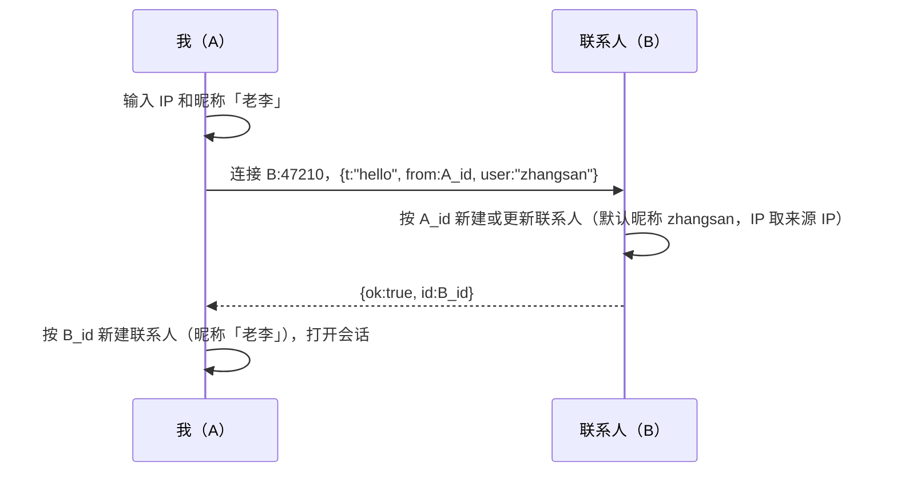
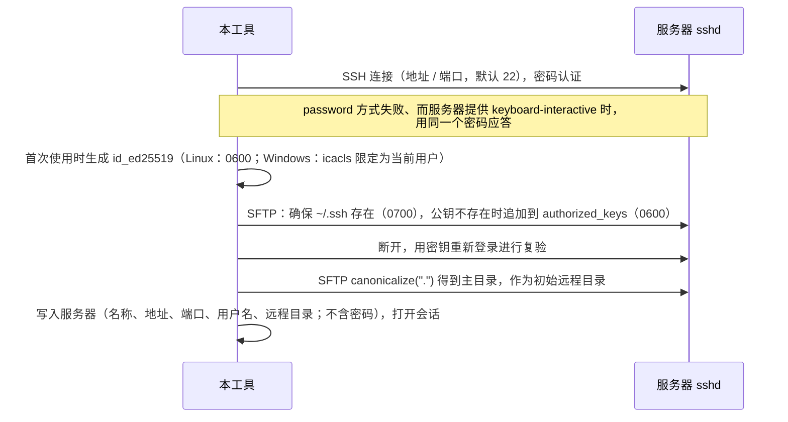

# Local Echo 详细设计方案

> 版本：**v1.0（定稿，全部待确认事项已确认）**　日期：2026-11-09
> 产品名称：Local Echo（`local-echo`），不设中文名。

**v0.4 变更摘要**

| 确认项（第三轮） | 调整 |
|---|---|
| 1 同名确认与图片 | 同名确认只针对**文件**，图片不参与（第 6 节）；所有图片写入 `files/` 时，都按保存时刻的本地时间重新命名（3.3） |
| 2 开机自启隐藏启动 | 确认采纳：自启时以 `--hidden` 启动，只驻留托盘（8.4） |
| 3 编辑服务器规则 | 确认采纳（5.3、3.2） |

为了格式化本地时间（图片文件名、消息时间、同名确认中的上次发送时间），新增 `chrono` 依赖。它本来就在 gpui-kit 的依赖树中（2.2）。

第三轮确认后新提出的 1 项（图片命名细节）已确认按建议执行，见 14.4。

---

## 0. 结论速览

| 项 | 方案 |
|---|---|
| 形态 | 单个可执行程序、单窗口；关闭窗口后驻留托盘，托盘菜单或设置页的「退出」才真正退出 |
| 与人交互 | TCP 直连，固定端口 `47210`，每条消息一条短连接。联系人以设备 ID 识别，IP 只是当前通信地址（收到对方消息时自动更新），昵称和 IP 都可以编辑 |
| 与机器交互 | 纯 Rust SSH（russh + russh-sftp）。密码只在添加服务器时用一次，用来把本工具的公钥写进服务器的 `authorized_keys`；之后上传、下载、打开终端都用这把密钥。服务器有名称，可以编辑 |
| 同名文件确认 | 给联系人发文件（图片除外）和上传到服务器时都会检查：本工具记录里有同名文件发送 / 上传成功过，就弹窗告知上次时间，用户确认后才继续 |
| 图片命名 | 所有写入 `files/` 的图片都以保存时刻命名，例如 `20261109-143205-123.png` |
| 在终端中打开 | 拉起系统终端执行 `ssh -i <工具密钥> …`，免密进入当前远程目录 |
| 存储 | 一个「数据目录」：`local-echo.db`（SQLite）、`files/`、`id_ed25519`、`device_id` |
| 设置 | 数据目录（即文件保存路径，更换即迁移）、开机自动启动、退出程序 |
| 托盘 | Windows 和 Linux 统一使用 `tray-icon`（Linux 走 KSNI，不依赖 GTK）；有未读消息时图标带圆点 |
| 发布 | 推送 `v*` 标签后，GitHub Actions 构建 Windows 安装程序（Inno Setup）和 Linux 的 deb / rpm |

---

## 1. 需求覆盖矩阵

| # | 需求 | 设计落点 | 章节 |
|---|---|---|---|
| F1 | 两大类场景：与人交互、与机器交互 | 联系人分两类：`kind=0` 人，`kind=1` 机器；侧边栏分为「联系人」「服务器」两组 | 3.2、9 |
| F2 | 点对点，没有中转或服务端 | 人：TCP 直连；机器：SSH 直连 | 4、5 |
| F3 | 两类场景都用聊天窗口 | 两类会话共用一个聊天视图 | 9 |
| F4 | 人：文本 | `text` 消息 | 4.4 |
| F5 | 人：表情 | **按第一轮确认移除** | — |
| F6 | 人：图片 | `image` 消息：可粘贴、选择或拖拽发送，在聊天中内联显示 | 4.4 |
| F7 | 人：文件传输 | `file` 消息：流式传输，两端都显示进度 | 4.4 |
| F8 | 人：通过指定 IP 添加对端 | 「添加联系人」：填写 IP 和昵称，然后 `hello` 握手 | 4.3 |
| F9 | 人：两端都需要安装本工具 | 对端需要运行本工具并监听 `47210` | 4.1 |
| F10 | 机器：从对端下载（对方给我发消息） | 在远程浏览器中选择文件，SFTP 下载，显示为左侧消息 | 5.5 |
| F11 | 机器：向对端上传（我给对方发消息） | 选择或拖入文件，SFTP 上传，显示为右侧消息 | 5.5 |
| F12 | 机器：在终端中打开 | 拉起系统终端，用 ssh 加工具密钥登录 | 5.6 |
| F13 | 机器：通过 IP / 用户名 / 密码添加 | 密码登录 → 部署公钥 → 用密钥复验 | 5.2 |
| F14 | 机器：对端不需要安装本工具，走 SSH | 只依赖标准 sshd 和 SFTP | 5 |
| F15 | 设置：文件保存路径 | 「数据目录」 | 7.1 |
| F16 | 设置：数据迁移 | 更换数据目录即迁移；换电脑时拷贝目录后选用 | 7.2 |
| C1-8 | 添加时设置昵称；可以编辑昵称和 IP；不以 IP 作为唯一标识 | 设备 ID + 本地昵称 | 4.1、4.3 |
| C1-9 | 托盘常驻，不需要系统通知 | `QuitMode::Explicit`、tray-icon、单实例唤起 | 8 |
| C1-11 / C2-2 / C2-3 / C3-1 | 同名文件确认：联系人和服务器都要，只针对文件，只依据本工具的记录，并告知上次时间 | 第 6 节 | 6 |
| C3-1 | 图片保存时按时间戳重命名 | 图片命名规则 | 3.3 |
| C3-2 | 开机自启时不弹出主窗口 | `--hidden` | 8.4 |
| C3-3 | 编辑服务器规则 | 直接保存、名称必填、不要求唯一 | 5.3、3.2 |
| C1-13 | Windows 和 Linux 都通过安装包安装 | Inno Setup / deb / rpm | 11 |
| C1-15 | 删除联系人及聊天记录，保留已传输的文件 | 级联删除消息 | 4.3、5.3 |
| C2-1 | 对端 IP 自动更新 | 收到已知设备的请求时更新 IP | 4.1 |
| C2-4 | 托盘未读提示 | 托盘图标带圆点 + 悬停提示 | 8.2 |
| C2-6 | 设置页「开机自动启动」，下次启动生效 | 注册表 Run 键 / XDG autostart | 8.4 |
| C2-8 | 服务器名称与编辑 | `contact.name`、编辑服务器对话框 | 5.3 |
| T1 | Rust + gpui（gpui-kit） | gpui-kit 0.9.1 | 2.2 |
| T2 | 用 SQLite 存记录；文件和图片不入库，库里只存路径 | 3.2、3.3 | 3 |
| T3 | 用 GitHub Actions 发布 Windows / Linux 版本 | `release.yml` | 11 |
| U1 | Claude Design 提示词 | 附录 A | 附录 A |

C1-x、C2-x、C3-x 分别表示第一、二、三轮确认中的第 x 项。

**不做**（需求没有提到，或已确认不做）：表情、在线状态、局域网自动发现、群聊、已读回执、撤回或编辑消息、搜索、系统通知、取消传输、断点续传、文件夹传输、加密传输、主机指纹校验、自动更新。

---

## 2. 总体架构

### 2.1 进程与线程模型

```
┌────────────────────────── local-echo（单进程、单实例）──────────────────────────┐
│                                                                                 │
│  gpui 主线程（UI，QuitMode::Explicit）          tokio 运行时（全部网络 I/O）     │
│  ┌──────────────────────┐   spawn 任务         ┌───────────────────────────┐   │
│  │ 主窗口（可关闭、重建）│ ───────────────────▶ │ peer：监听 47210、发送    │   │
│  │ 对话框 / 设置         │                      │ host：SSH / SFTP          │   │
│  └──────────▲───────────┘   Event 通道         └─────────────┬─────────────┘   │
│             ├───────────────────────────────────────────────┘                 │
│             └──── 托盘事件（tray-icon 回调转发到同一个通道）                     │
│                                                                                 │
│  数据目录：local-echo.db  files/  id_ed25519  device_id                          │
└─────────────────────────────────────────────────────────────────────────────────┘
        │ TCP 47210（直连联系人）                     │ SSH（直连服务器）
```

- **tokio**：在 `main` 中创建多线程运行时，把 `Handle` 放入全局状态。UI 通过 `handle.spawn(...)` 发起网络操作；需要结果时直接 `await` 返回的 `JoinHandle`（它是普通 `Future`，可以跨执行器 await）。
- **事件通道**：网络任务和托盘回调都只通过一个 `tokio::sync::mpsc::UnboundedSender<Event>` 通知 UI。gpui 前台用一个任务循环执行 `rx.recv().await`，这条链路已实测可用。
- **数据库**：共享一个 `Arc<Mutex<rusqlite::Connection>>`，开启 WAL。
- **主窗口**只负责展示。联系人、未读数、当前会话等状态都放在全局状态里，所以窗口可以随时关闭和重建。

```rust
enum Event {
    MessageAdded(Message),                  // 收到新消息，或新建了一条传输
    Progress { id: String, done: u64 },     // 传输进度，发送端最多每 100ms 发一次
    Status { id: String, status: Status },  // 进行中 → 成功 / 失败
    ContactChanged(Contact),                // 新联系人，或 IP 被自动更新
    ShowWindow,                             // 托盘单击、托盘菜单「打开」、第二个实例要求唤起
    Quit,                                   // 托盘菜单「退出」
}
```

### 2.2 技术选型（版本于 2026-11-09 实测）

| 用途 | 选型 | 理由 |
|---|---|---|
| UI | `gpui-kit = "=0.9.1"`（固定 `gpui-pre 0.3.12`） | 技术栈指定；自带 `Message`、`Bubble`、`Attachment`、`MessageScroller`、`Sidebar`、`Dialog`、`Textarea`（`on_paste`）、`Setting`、`Switch`、`TitleBar` |
| 异步运行时 | `tokio` | russh 依赖它，网络 I/O 统一放在上面 |
| SSH / SFTP | `russh 0.65`（关闭默认特性，启用 `ring`、`rsa`、`flate2`）+ `russh-sftp 3` | 纯 Rust 实现，不依赖 OpenSSL；用 `ring` 后 Windows CI 不需要 NASM / CMake |
| 密钥生成 | `rand 0.10` + `russh::keys::PrivateKey::random(Ed25519)` | — |
| 托盘 | `tray-icon 0.26`（关闭默认特性，启用 `ksni`） | 一个 crate 覆盖两个平台，Linux 下不依赖 GTK；支持运行时 `set_icon` / `set_tooltip` |
| 托盘图标解码 | `image 0.25`（只启用 `png`） | 已在 gpui 的依赖树里 |
| 开机自启（Windows） | `winreg 0.56`（仅 Windows） | 读写 `HKCU\…\Run`。Linux 只需写一个文件，不需要依赖 |
| 本地时间格式化 | `chrono 0.4` | 用于图片文件名、消息时间、同名确认中的上次时间；已在 gpui-kit 的依赖树中（含 `clock` 特性），不增加编译量 |
| 数据库 | `rusqlite 0.41`（`bundled`） | 静态链接 SQLite |
| 其他 | `serde`、`serde_json`、`uuid`、`dirs`、`local-ip-address`、`anyhow` | 各自只承担单一用途 |
| 打包 | Windows：Inno Setup 6（runner 已预装）+ `winresource`；Linux：`cargo-deb`、`cargo-generate-rpm` | 见第 11 节 |

---

## 3. 数据存储

### 3.1 数据目录

```
<数据目录>/
├── local-echo.db      # SQLite：联系人 + 消息
├── device_id          # 本机设备 ID（UUID，纯文本），首次启动时生成
├── id_ed25519         # 工具专用 SSH 私钥，首次添加服务器时生成
└── files/             # 收到 / 下载的文件和图片，以及我发出的图片（扁平存放；文件保留原名，重名时追加 " (1)"；图片按时间戳命名）
```

- 默认位置：Linux 为 `~/.local/share/local-echo`，Windows 为 `%LOCALAPPDATA%\local-echo`。
- 指针文件：`<系统配置目录>/local-echo/data_dir`，只有一行绝对路径；文件不存在时使用默认位置。
- 「开机自动启动」不存在数据目录里。它的状态以系统中的自启项是否存在为准（8.4）。

### 3.2 表结构

```sql
PRAGMA journal_mode = WAL;
PRAGMA foreign_keys = ON;

CREATE TABLE IF NOT EXISTS contact (
  id         INTEGER PRIMARY KEY,
  kind       INTEGER NOT NULL,            -- 0 = 人（联系人），1 = 机器（服务器）
  name       TEXT    NOT NULL,            -- 联系人昵称 / 服务器名称（本地设置，可编辑）
  host       TEXT    NOT NULL,            -- 人：对端当前 IP；机器：服务器地址
  port       INTEGER NOT NULL,            -- 人：47210；机器：SSH 端口
  user       TEXT    NOT NULL DEFAULT '', -- 机器：SSH 用户名
  peer_id    TEXT,                        -- 人：对端设备 ID（唯一标识）
  remote_dir TEXT    NOT NULL DEFAULT ''  -- 机器：当前远程目录
);
CREATE UNIQUE INDEX IF NOT EXISTS contact_peer ON contact (peer_id) WHERE kind = 0;

CREATE TABLE IF NOT EXISTS message (
  id          TEXT    PRIMARY KEY,        -- UUID；人场景下两端一致，用于重试去重
  contact_id  INTEGER NOT NULL REFERENCES contact(id) ON DELETE CASCADE,
  outgoing    INTEGER NOT NULL,           -- 1 = 我发出（右侧），0 = 对方发来（左侧）
  kind        INTEGER NOT NULL,           -- 0 = 文本，1 = 图片，2 = 文件
  body        TEXT    NOT NULL,           -- 文本内容或文件名
  path        TEXT,                       -- 本地文件路径（规则见 3.3）
  remote_path TEXT,                       -- 机器：远端完整路径
  size        INTEGER,
  status      INTEGER NOT NULL,           -- 0 = 进行中，1 = 成功，2 = 失败
  ts          INTEGER NOT NULL            -- 本地时间（毫秒）
);
CREATE INDEX IF NOT EXISTS message_by_contact ON message (contact_id);
```

- 服务器条目只以 `id` 区分，不要求「地址 + 用户名」唯一（已确认）。
- 消息按本地 `rowid` 排序显示。启动时执行 `UPDATE message SET status = 2 WHERE status = 0`，把上次未完成的传输标为失败。
- 删除联系人或服务器：执行 `DELETE FROM contact WHERE id = ?`，消息随之级联删除；`files/` 里的文件不动。

### 3.3 文件与图片存放规则

| 场景 | 实际存放 | `message.path` |
|---|---|---|
| 收到的文件（人） | `files/<原文件名>` | 相对路径 |
| 收到的图片（人） | `files/<时间戳>.<扩展名>` | 相对路径 |
| 从服务器下载的文件 | `files/<原文件名>` | 相对路径 |
| 我发出的图片（选择、拖入或粘贴） | 复制到 `files/<时间戳>.<扩展名>`（粘贴的图片扩展名为 `.png`） | 相对路径 |
| 我发出的文件（人）、上传的文件（机器） | 不复制 | 原文件的绝对路径 |

- **图片命名（C3-1）**：所有写入 `files/` 的图片都用保存时刻的本地时间命名，格式为 `YYYYMMDD-HHMMSS-mmm.<扩展名>`，例如 `20261109-143205-123.png`，用 chrono 格式化。发送方在复制时命名，接收方在接收时按自己的时间命名，两边各自独立（已确认）。同一毫秒内重名时，也按下面的规则追加序号。图片消息的 `body` 记录的就是这个保存后的文件名。
- **文件名处理**：只取路径的最后一段；Windows 下把 `\/:*?"<>|` 替换为 `_`；重名时追加 ` (1)`、` (2)`……

---

## 4. 与人交互

### 4.1 身份与寻址

- **设备 ID**：每个安装实例首次启动时生成一个 UUID，存放在 `<数据目录>/device_id`。**联系人以对端的设备 ID 唯一标识**；IP 只是当前通信地址。所有实例都监听 `0.0.0.0:47210`。
- **昵称**：添加联系人时设置，之后可以编辑；只保存在本地。界面显示为「昵称 · IP」。
- **被动建立联系人**：收到未知设备的请求时，自动新建联系人。默认昵称为对方的系统用户名（协议字段 `user`），IP 为本次连接的来源 IP。
- **IP 自动更新（已确认）**：收到已知设备的请求，且来源 IP 与记录不同时，把记录更新为来源 IP。
- **防止发错人**：每个请求都携带目标设备 ID `to`。接收方发现不是自己就拒收，发送方提示「发送失败：{IP} 当前不是「{昵称}」的设备，请修改 IP」。

### 4.2 传输协议

一条消息一条 TCP 短连接：连接 → 写请求 → 读响应 → 关闭。

```
请求：[u32 大端 N][N 字节 JSON 头][size 字节文件内容（仅 image / file）]
响应：[u32 大端 M][M 字节 JSON]
```

| 请求头字段 | 说明 |
|---|---|
| `t` | `hello` / `text` / `image` / `file` / `show`（`show` 见 8.3） |
| `from` | 发送方设备 ID |
| `to` | 接收方设备 ID（`hello`、`show` 没有） |
| `user` | 发送方系统用户名，只用作对方自动建立联系人时的默认昵称 |
| `id` | 消息 UUID |
| `text` | 文本内容 |
| `file`、`size` | 文件名、字节数。图片只用到文件名中的扩展名，接收方按时间戳重新命名 |

响应：成功为 `{"ok":true}`，`hello` 的响应额外带上 `"id":"<接收方设备 ID>"`；失败为 `{"ok":false,"err":"wrong_peer" | "<原因>"}`。

**接收方处理顺序**：
1. `t = show`：只接受来自本机回环地址的请求，唤起窗口。
2. `to` 存在且不等于本机 ID：返回 `wrong_peer`。
3. 按 `from` 查找联系人：不存在则新建，IP 变了则更新。
4. 按 `t` 处理。

**超时**：连接 3 秒；传输过程中连续 30 秒没有任何进展即判定失败。

### 4.3 添加、编辑、删除联系人



- **添加**：IP 和昵称都必填。
  - 连接失败时提示「无法连接 {IP}：对方未运行 Local Echo，或网络不可达」，不添加。
  - 返回的设备 ID 已在列表中时，更新该联系人的 IP 和昵称并打开会话，提示「该联系人已在列表中，已更新 IP 和昵称」。
- **编辑**（右键 →「编辑」）：可修改昵称和 IP，直接保存，不做连接校验。
- **删除**（右键 →「删除」，需二次确认）：删除联系人及其聊天记录，保留已传输的文件。

### 4.4 收发消息

| 类型 | 发送入口 | 接收端处理 | 显示 |
|---|---|---|---|
| 文本 | 输入框：Enter 发送，Shift+Enter 换行 | 入库 | 气泡，文字可选中复制 |
| 图片 | ① 在输入框粘贴图片 ② 点附件按钮选择 ③ 拖到聊天区。扩展名为 `png/jpg/jpeg/gif/webp/bmp` 时按图片处理 | 流式写入 `files/<时间戳>.<扩展名>` | 内联缩略图，最大 240×240、保持比例；点击后用系统查看器打开 |
| 文件 | ① 附件按钮（可多选）② 拖到聊天区 ③ 粘贴已复制的文件 | 流式写入 `files/<原文件名>`，自动接收 | `Attachment` 卡片；完成后可「打开」「打开所在文件夹」 |

- 文件在发出前要先经过**同名文件确认**（第 6 节）；图片不需要。
- **传输流程**：
  1. 发送端插入一条 `status = 0` 的消息。
  2. 连接对端，写入请求头，再按 256 KB 分块写入内容，同时发送进度。
  3. 接收端执行 `INSERT … ON CONFLICT(id) DO UPDATE SET status = 0`，把内容流式写入 `files/`，完成后标记成功并回复 `ok`；出错时删除半成品文件，标记失败。
- **失败与重试**：显示「发送失败 · 重试」。重试使用同一个 id，接收方按 id 覆盖，不会出现重复消息；重试不触发同名确认。
- **未读**：收到联系人发来的消息时，如果主窗口已关闭，或者该会话不是当前打开的会话，就给这个联系人的未读数加一（只保存在内存中）。侧边栏显示每个联系人的未读数，托盘显示总数（8.2）。打开会话即清零。不发系统通知。

---

## 5. 与机器交互

### 5.1 认证方案（已确认）

本工具持有一把 ed25519 密钥 `<数据目录>/id_ed25519`。添加服务器时用密码登录一次，把公钥追加到服务器的 `~/.ssh/authorized_keys`（注释为 `local-echo@<本机名>`）。此后所有操作都用这把密钥，密码不落盘。删除服务器时不清理这行公钥。

### 5.2 添加服务器



- **字段**：名称、地址（`IP[:端口]`，默认端口 22）、用户名、密码，都必填。
- **报错**：
  - 「无法连接 {host}:{port}」
  - 「用户名或密码错误」
  - 「公钥已写入，但无法用密钥登录：服务器可能禁用了公钥认证」

  出现任意一种都不会添加服务器。
- **重新授权**：密钥登录失败时，会话顶部显示横幅「无法登录该服务器，访问密钥可能已失效」和「重新授权」按钮。点击后打开授权对话框，名称、地址和用户名已预填且只读，只需填写密码，之后按上图流程重新部署公钥。
- **主机指纹**：不校验（已确认）。

### 5.3 编辑与删除服务器（C2-8）

- **编辑**（右键 →「编辑」）：可修改名称、地址（`IP[:端口]`）、用户名，直接保存，不做连接校验，远程目录保持不变。
  - 如果新的地址或用户名上没有部署过本工具的公钥，下次操作会触发「重新授权」横幅，填一次密码即可。
  - 修改地址或用户名后，会丢弃该服务器缓存的 SFTP 连接。
- **删除**（右键 →「删除」，需二次确认）：删除服务器及其传输记录，保留已下载的文件。

### 5.4 远程目录

每台服务器有一个**当前远程目录**（`contact.remote_dir`），显示在会话顶部。上传、浏览下载、在终端中打开都基于这个目录。

**远程浏览器**（对话框）有两种模式：

| 模式 | 打开方式 | 底部按钮 |
|---|---|---|
| 选择目录 | 点击顶部的「更改」 | 「选择此目录」 |
| 选择文件 | 点击「下载文件」 | 可多选，「下载所选」 |

- 界面元素：路径栏（可直接输入路径后回车跳转）、「上一级」按钮、文件列表（图标 / 名称 / 大小 / 修改时间，目录排在前面，双击进入目录）。
- 数据来源：SFTP `read_dir`。遇到符号链接时再取一次 `metadata`，判断它指向的是否为目录。

### 5.5 上传与下载

| 操作 | 入口 | 消息方向 | 本地 / 远端 |
|---|---|---|---|
| 上传（我给对方发消息） | 「上传文件」按钮（可多选），或把文件拖到会话区；**先经过同名文件确认**（第 6 节） | 右侧 | 原文件 → `<remote_dir>/<文件名>` |
| 下载（对方给我发消息） | 「下载文件」→ 在远程浏览器中多选 | 左侧 | 远端文件 → `files/<文件名>` |

- 每个文件是一条消息，用 `Attachment` 卡片显示进度和状态；按 256 KB 分块读写。
- SFTP 连接复用：每台服务器缓存一个 `Arc<SftpSession>`，首次使用时用密钥建立，之后各操作并发复用。任何操作出错就丢弃缓存，下次操作时重新连接。

### 5.6 在终端中打开（已确认）

```
ssh -i <数据目录>/id_ed25519 -p <port>
    -o IdentitiesOnly=yes -o StrictHostKeyChecking=no
    -o UserKnownHostsFile=<Linux: /dev/null | Windows: NUL> -o LogLevel=ERROR
    -t <user>@<host> "cd '<remote_dir>'; exec $SHELL -l"
```

| 平台 | 拉起方式 |
|---|---|
| Windows | `Command::new("ssh").creation_flags(CREATE_NEW_CONSOLE)`，使用系统自带的 OpenSSH 客户端 |
| Linux | 优先使用 `x-terminal-emulator`：解析其软链接得到真实终端，再按下表组装参数。没有它时按下表顺序查找；全都找不到时提示「未找到可用的终端程序」 |

| Linux 终端 | 命令形式 |
|---|---|
| ptyxis | `ptyxis --new-window -- ssh …` |
| gnome-terminal | `gnome-terminal -- ssh …` |
| konsole | `konsole -e ssh …` |
| xfce4-terminal | `xfce4-terminal -x ssh …` |
| kitty / foot | `kitty ssh …` / `foot ssh …` |
| alacritty | `alacritty -e ssh …` |
| wezterm | `wezterm start -- ssh …` |
| xterm | `xterm -e ssh …` |

私钥权限在两个时机设置：生成密钥时、迁移数据目录后。Linux 用 `chmod 600`；Windows 用 `icacls <key> /inheritance:r /grant:r "%USERNAME%:F"`。

---

## 6. 同名文件确认（C1-11、C2-2、C2-3、C3-1）

**触发时机**：发出**新的文件**时，即：
- 联系人会话：通过附件按钮、拖入、粘贴已复制的文件这三种方式发出、且被判定为文件的内容；
- 服务器会话：「上传文件」按钮、拖入。

以下情况不触发：图片（已确认，图片保存时会按时间戳重命名，见 3.3）；重试失败的消息。

**判断依据**：只看本工具的成功记录（已确认）：

```sql
SELECT ts FROM message
WHERE contact_id = ? AND outgoing = 1 AND status = 1 AND <同名条件>
ORDER BY rowid DESC LIMIT 1;
```

| 场景 | 同名条件 | 含义 |
|---|---|---|
| 联系人 | `kind = 2 AND body = ?`（文件名） | 曾向该联系人成功发送过同名文件 |
| 服务器 | `remote_path = ?`（`<remote_dir>/<文件名>`） | 曾成功上传到同一个远程路径 |

一次选择或拖入中同时有图片和文件时，图片直接发送，只有同名的文件进入确认弹窗。

**确认弹窗**：两个场景用同一个对话框组件，只是文案不同。同一批文件合并到一个弹窗中处理；都没有同名记录时直接发送，不弹窗。

| | 联系人 | 服务器 |
|---|---|---|
| 标题 | 已发送过同名文件 | 已上传过同名文件 |
| 列表（每个同名文件一行） | {文件名} — 上次发送于 {时间} | {文件名} — 上次上传于 {时间} |
| 说明 | 继续发送后，对方会再收到一份。 | 继续上传将覆盖服务器上 {remote_dir} 中的同名文件。 |
| 按钮 | 取消（整批不发送）/ 继续发送（整批发送） | 取消 / 继续上传 |

---

## 7. 设置

设置页的内容：

| 设置项 | 控件 | 说明 |
|---|---|---|
| 数据目录 | 路径 +「打开」「更改…」 | 7.1、7.2 |
| 开机自动启动 | 开关 | 8.4 |
| 退出 Local Echo | 按钮 | 8.1 |
| 关于 | 版本号 | — |

本机 IP 显示在侧边栏顶部。

### 7.1 数据目录（即文件保存路径）

显示当前路径，旁边有「打开」（在文件管理器中打开）和「更改…」两个按钮。

### 7.2 数据迁移

| 目标目录 | 行为 |
|---|---|
| 已包含 `local-echo.db` | 确认「使用该目录中的已有数据？当前数据将保留在原位置。」→ 改写指针文件 → `cx.restart()` |
| 不包含 | 确认「将全部数据移动到 X？」→ 关闭数据库 → 移动 `local-echo.db`、`device_id`、`id_ed25519`、`files/`（同一分区直接 `rename`，跨分区先复制再删除，并显示进度）→ 修正私钥权限 → 改写指针文件 → `cx.restart()` |

- 换电脑时，把整个数据目录拷到新电脑，在设置里「更改…」选中它即可。
- 有传输正在进行时，提示「有传输正在进行，请完成后再迁移」。

---

## 8. 托盘常驻、单实例与开机自启

### 8.1 托盘常驻

| 行为 | 实现 |
|---|---|
| 关闭主窗口 | 以 `QuitMode::Explicit` 运行。关闭窗口只是关掉窗口，监听和传输继续进行 |
| 打开主窗口 | 托盘左键单击（Windows）/ 激活（Linux），或托盘菜单「打开 Local Echo」，发出 `Event::ShowWindow`。窗口不存在则 `open_window` 重建，存在则 `activate_window` |
| 退出 | 托盘菜单「退出」，或设置页「退出 Local Echo」，执行 `cx.quit()` |

- **托盘实现**：使用 `tray-icon`。Windows 上是 Shell_NotifyIcon，Linux 上是 KSNI（StatusNotifierItem）。菜单和点击事件通过 `set_event_handler` 转发到事件通道。图标是内嵌的 PNG，用 `image` 解码后传给 `Icon::from_rgba`。
- **没有托盘宿主的 Linux 桌面**（已确认）：不做探测，行为保持一致。关闭窗口后程序驻留后台；再次启动程序会唤起窗口；可以在设置页退出。
- 窗口的 `app_id` 为 `local-echo`，与 `.desktop` 文件中的 `StartupWMClass` 一致。

### 8.2 托盘未读提示（C2-4）

- 所有联系人的未读数之和大于 0 时：调用 `tray.set_icon(带圆点的图标)` 和 `tray.set_tooltip("Local Echo · {n} 条未读")`。
- 未读数归零时：恢复常规图标，提示文字恢复为 `Local Echo`。
- 未读数的计算规则见 4.4。服务器的下载结果是我主动发起的，不计入未读。

### 8.3 单实例

再次启动程序时：
1. 绑定 `47210` 失败；
2. 连接 `127.0.0.1:47210`，发送 `{"t":"show"}`；
3. 已运行的实例唤起主窗口，新进程退出。

如果第 2 步连接也失败，说明端口被其他程序占用，提示「端口 47210 被其他程序占用」。

### 8.4 开机自动启动（C2-6）

- 设置页提供开关「开机自动启动」，说明文字为「开启后，下次登录系统时 Local Echo 会自动在后台启动」。
- 开关**不另外存储状态**：打开设置页时直接读取系统中的自启项是否存在；切换开关时立即写入或删除自启项，下次登录系统时生效。
- 自启时带 `--hidden` 参数启动：只驻留托盘，不打开主窗口（已确认）。

| 平台 | 自启项 |
|---|---|
| Windows | 注册表 `HKCU\Software\Microsoft\Windows\CurrentVersion\Run`，值名 `Local Echo`，数据为 `"<exe 路径>" --hidden`（用 `winreg` 读写） |
| Linux | `~/.config/autostart/local-echo.desktop`（XDG Autostart 规范，GNOME / KDE / Xfce 通用），内容见下 |

```ini
[Desktop Entry]
Type=Application
Name=Local Echo
Exec=/usr/bin/local-echo --hidden
TryExec=/usr/bin/local-echo
Icon=local-echo
Terminal=false
X-GNOME-Autostart-enabled=true
```

- `Exec` 和 `TryExec` 使用 `std::env::current_exe()` 的实际路径。`TryExec` 的作用是：软件卸载后，桌面环境会因为找不到程序而自动跳过这一项，避免留下失效的自启。
- Windows 卸载时，由安装程序删除注册表中的自启项（11.1）。

---

## 9. 界面结构（视觉由 Claude Design 产出）

```
┌───────────────────────────────────────────────────────────────┐
│ [logo] Local Echo                              — ☐ ✕ (标题栏) │
├──────────────────┬────────────────────────────────────────────┤
│ 本机 IP 192.168… │  会话头：名称 · 地址        [会话操作按钮] │
│──────────────────│────────────────────────────────────────────│
│ 联系人       [+] │                                            │
│  老李 · .23  (2) │              消息列表（虚拟滚动）           │
│  小王 · .41      │                                            │
│ 服务器       [+] │                                            │
│  测试机          │────────────────────────────────────────────│
│  root@10.0.0.5   │  底部：联系人 = 附件 / 输入框 / 发送       │
│ [⚙ 设置]         │        服务器 = 拖拽区 + 上传按钮          │
└──────────────────┴────────────────────────────────────────────┘
```

| 视图 | 组成 | 主要组件 |
|---|---|---|
| 主窗口 | 自绘标题栏 + 侧边栏 + 会话区；默认 1000×680，最小 760×520 | `TitleBar`、`Sidebar`、`Avatar`、`Badge` |
| 联系人会话 | 头部（昵称 · IP）；消息列表；底部：附件按钮、多行输入框、发送按钮；拖入文件时显示覆盖层 | `MessageScroller`、`Message`、`Bubble`、`Attachment`、`Textarea` |
| 服务器会话 | 头部：名称、`user@host:port`、远程目录 +「更改」、「下载文件」「在终端中打开」；消息列表；底部：拖拽提示 +「上传文件」 | 同上 + `Button` |
| 添加 / 编辑联系人 | 添加：对方 IP、昵称；编辑：昵称、IP | `Dialog`、`Input` |
| 添加 / 编辑服务器 | 添加：名称、地址、用户名、密码，提交后显示步骤进度；编辑：名称、地址、用户名 | `Dialog`、`Input`、`Spinner` |
| 重新授权 | 名称、地址、用户名只读，只填密码 | `Dialog` |
| 远程浏览器 | 路径栏、上一级、文件列表、底部按钮随模式变化 | `Dialog`、`Table` |
| 同名文件确认 | 两种文案（第 6 节） | `Dialog` |
| 设置 | 数据目录、开机自动启动、退出、版本；迁移确认与进度 | `Setting`、`Switch`、`Progress` |
| 右键菜单 | 联系人：编辑、删除；服务器：编辑、删除 | 上下文菜单 |
| 托盘 | 常规 / 未读两种图标；菜单：打开 Local Echo、退出 | 系统原生 |

---

## 10. 工程结构

```
local-echo/
├── Cargo.toml
├── build.rs                         # 仅 Windows：嵌入 assets/app.ico
├── assets/                          # Claude Design 产出
│   ├── app.ico
│   ├── icons/hicolor/…              # Linux 应用图标：48/128/256/512 PNG + scalable SVG
│   ├── tray.png / tray-unread.png   # 托盘图标，32×32
│   ├── theme.json                   # gpui-kit 主题（浅色 + 深色）
│   └── local-echo.desktop
├── packaging/windows/local-echo.iss
├── src/
│   ├── main.rs                      # 单实例 → 读指针文件 → 打开数据库 → 启动 tokio 与监听 → 托盘 → 主窗口（--hidden 时不开） → 事件桥
│   ├── data.rs                      # 数据目录、指针文件、device_id、迁移、文件名处理
│   ├── db.rs                        # 表结构与增删改查（含同名查询）
│   ├── peer.rs                      # 与人交互：协议、监听、发送
│   ├── host.rs                      # 与机器交互：认证与部署公钥、SFTP、打开终端
│   ├── desktop.rs                   # 托盘（常规 / 未读）、开机自启
│   └── ui/
│       ├── app.rs                   # 主窗口、侧边栏
│       ├── chat.rs                  # 会话视图（按 kind 切换头部和底部）
│       ├── dialogs.rs               # 添加 / 编辑联系人、添加 / 编辑 / 重新授权服务器、远程浏览器、同名确认
│       └── settings.rs
└── .github/workflows/release.yml
```

```toml
[package]
name = "local-echo"
version = "0.1.0"
edition = "2024"
description = "Local Echo: LAN peer-to-peer chat, file transfer and SSH file exchange"
license = "Proprietary"

[dependencies]
gpui-kit = "=0.9.1"
tokio = { version = "1", features = ["rt-multi-thread", "net", "io-util", "fs", "sync", "time", "macros"] }
russh = { version = "0.65", default-features = false, features = ["ring", "rsa", "flate2"] }
russh-sftp = "3"
rand = "0.10"
rusqlite = { version = "0.41", features = ["bundled"] }
tray-icon = { version = "0.26", default-features = false, features = ["ksni"] }
image = { version = "0.25", default-features = false, features = ["png"] }
serde = { version = "1", features = ["derive"] }
serde_json = "1"
uuid = { version = "1", features = ["v4"] }
dirs = "6"
local-ip-address = "0.6"
chrono = "0.4"
anyhow = "1"

[target.'cfg(windows)'.dependencies]
winreg = "0.56"

[target.'cfg(windows)'.build-dependencies]
winresource = "0.1"

[package.metadata.deb]
maintainer = "Local Echo"
section = "net"
depends = "$auto, libvulkan1, libwayland-client0, libfontconfig1, openssh-client"
assets = [
  ["target/release/local-echo", "usr/bin/", "755"],
  ["assets/local-echo.desktop", "usr/share/applications/", "644"],
  ["assets/icons/hicolor/256x256/apps/local-echo.png", "usr/share/icons/hicolor/256x256/apps/", "644"],
  # …其余尺寸同理
]

[package.metadata.generate-rpm]
assets = [
  { source = "target/release/local-echo", dest = "/usr/bin/local-echo", mode = "755" },
  { source = "assets/local-echo.desktop", dest = "/usr/share/applications/local-echo.desktop", mode = "644" },
  { source = "assets/icons/hicolor/256x256/apps/local-echo.png", dest = "/usr/share/icons/hicolor/256x256/apps/local-echo.png", mode = "644" },
  # …其余尺寸同理
]
[package.metadata.generate-rpm.requires]
openssh-clients = "*"
vulkan-loader = "*"
libwayland-client = "*"
fontconfig = "*"
```

`assets/local-echo.desktop`（已通过 `desktop-file-validate` 校验）：

```ini
[Desktop Entry]
Type=Application
Name=Local Echo
Comment=LAN peer-to-peer chat, file transfer and SSH file exchange
Exec=local-echo
Icon=local-echo
Terminal=false
Categories=Network;FileTransfer;
StartupWMClass=local-echo
```

`main.rs` 顶部加上 `#![cfg_attr(windows, windows_subsystem = "windows")]`，Windows 下运行时不弹出控制台窗口。

---

## 11. 构建、安装包与发布

### 11.1 安装包（已确认）

| 平台 | 形式 | 要点 |
|---|---|---|
| Windows | Inno Setup 安装程序 `local-echo-<版本>-windows-x86_64-setup.exe` | 安装到 `Program Files\Local Echo`，需要管理员权限；创建开始菜单快捷方式，桌面快捷方式可选；自动添加 TCP 47210 入站防火墙规则；升级或卸载前强制关闭正在运行的程序；卸载时删除防火墙规则和当前用户的开机自启项，保留用户数据；安装完成后以当前用户身份启动程序；界面为简体中文；不做代码签名 |
| Linux | `local-echo_<版本>-1_amd64.deb`、`local-echo-<版本>-1.x86_64.rpm` | 在 `ubuntu-22.04` 上构建，要求 glibc ≥ 2.35；依赖由包管理器自动安装 |

`packaging/windows/local-echo.iss`（以 UTF-8 BOM 编码保存）：

```iss
#ifndef AppVersion
  #define AppVersion "0.0.0"
#endif

[Setup]
AppId={{140AB8F3-F901-46F3-AA78-68A210345FB5}
AppName=Local Echo
AppVersion={#AppVersion}
AppPublisher=Local Echo
DefaultDirName={autopf}\Local Echo
DisableProgramGroupPage=yes
PrivilegesRequired=admin
ArchitecturesAllowed=x64compatible
ArchitecturesInstallIn64BitMode=x64compatible
MinVersion=10.0.17763
SetupIconFile=..\..\assets\app.ico
UninstallDisplayIcon={app}\local-echo.exe
CloseApplications=force
RestartApplications=no
OutputDir=..\..\target\installer
OutputBaseFilename=local-echo-{#AppVersion}-windows-x86_64-setup

[Languages]
Name: "chs"; MessagesFile: "compiler:Languages\ChineseSimplified.isl"

[Tasks]
Name: "desktopicon"; Description: "创建桌面快捷方式"

[Files]
Source: "..\..\target\release\local-echo.exe"; DestDir: "{app}"; Flags: ignoreversion

[Icons]
Name: "{autoprograms}\Local Echo"; Filename: "{app}\local-echo.exe"
Name: "{autodesktop}\Local Echo"; Filename: "{app}\local-echo.exe"; Tasks: desktopicon

[Run]
Filename: "{sys}\netsh.exe"; Parameters: "advfirewall firewall delete rule name=""Local Echo"""; Flags: runhidden
Filename: "{sys}\netsh.exe"; Parameters: "advfirewall firewall add rule name=""Local Echo"" dir=in action=allow protocol=TCP localport=47210 program=""{app}\local-echo.exe"" profile=any"; Flags: runhidden
Filename: "{app}\local-echo.exe"; Description: "启动 Local Echo"; Flags: nowait postinstall skipifsilent runasoriginaluser

[UninstallRun]
Filename: "{sys}\netsh.exe"; Parameters: "advfirewall firewall delete rule name=""Local Echo"""; Flags: runhidden; RunOnceId: "DelFwRule"
Filename: "{sys}\reg.exe"; Parameters: "delete ""HKCU\Software\Microsoft\Windows\CurrentVersion\Run"" /v ""Local Echo"" /f"; Flags: runhidden; RunOnceId: "DelAutostart"
```

- 卸载时用 `reg delete` 清除开机自启项。Inno 的 `[Registry]` 段需要在安装时就创建这个值，而自启项是用户在设置页里手动开启的，所以不适用。
- `CloseApplications=force`：程序驻留托盘时可能没有可见窗口，Restart Manager 无法请求它正常关闭。

### 11.2 GitHub Actions

```yaml
# .github/workflows/release.yml
name: release
on:
  push:
    tags: ["v*"]
permissions:
  contents: write

jobs:
  windows:
    runs-on: windows-latest                  # 预装 Inno Setup 6.7.1
    steps:
      - uses: actions/checkout@v4
      - uses: dtolnay/rust-toolchain@stable
      - uses: Swatinem/rust-cache@v2
      - run: cargo build --release --locked
      - name: Build installer
        shell: pwsh
        run: |
          $v = "${{ github.ref_name }}".TrimStart("v")
          & "${env:ProgramFiles(x86)}\Inno Setup 6\ISCC.exe" "/DAppVersion=$v" packaging\windows\local-echo.iss
      - uses: actions/upload-artifact@v4
        with: { name: windows, path: target/installer/*.exe }

  linux:
    runs-on: ubuntu-22.04                    # glibc 2.35
    steps:
      - uses: actions/checkout@v4
      - uses: dtolnay/rust-toolchain@stable
      - uses: Swatinem/rust-cache@v2
      - name: Install build dependencies
        run: |
          sudo apt-get update
          sudo apt-get install -y gcc g++ pkg-config libfontconfig-dev libwayland-dev \
            libxkbcommon-x11-dev libx11-xcb-dev libvulkan1
          cargo install --locked cargo-deb cargo-generate-rpm
      - run: cargo build --release --locked
      - name: Build deb / rpm
        run: |
          cargo deb --no-build
          cargo generate-rpm
      - uses: actions/upload-artifact@v4
        with:
          name: linux
          path: |
            target/debian/*.deb
            target/generate-rpm/*.rpm

  release:
    needs: [windows, linux]
    runs-on: ubuntu-latest
    steps:
      - uses: actions/download-artifact@v4
        with: { path: dist, merge-multiple: true }
      - uses: softprops/action-gh-release@v2
        with: { files: dist/* }
```

发版流程：修改 `Cargo.toml` 中的版本号 → 提交 → `git tag v0.1.0 && git push --tags`。

---

## 12. 技术验证记录（2026-11-09，Ubuntu 26.04 / Rust 1.99.1）

| # | 验证项 | 结果 |
|---|---|---|
| 1 | gpui-kit 仓库与版本 | ✅ 原 gpui-component 已改名为 gpui-kit；`gpui-kit 0.9.1` 固定 `gpui-pre =0.3.12` |
| 2 | gpui-kit 在 Linux 上编译运行 | ✅ |
| 3 | 聊天组件 | ✅ `Message`、`Bubble`、内联图片、`Attachment` 进度卡片，截图确认 |
| 4 | 剪贴板图片 / 文件 | ✅ 源码确认 Windows、Wayland、X11 都支持；可通过 `Textarea::on_paste` 拦截 |
| 5 | 拖放、文件对话框、打开文件、在文件夹中显示、重启 | ✅ 源码确认 |
| 6 | 关闭全部窗口后进程不退出，并能重建窗口 | ✅ `QuitMode::Explicit` |
| 7 | tokio 通道 → gpui 前台的事件桥 | ✅ |
| 8 | Linux 托盘 | ✅ `tray-icon`（ksni）在 GNOME（AppIndicator 扩展）上注册成功，无 GTK 依赖；源码确认 KSNI 后端支持运行时 `set_icon` / `set_tooltip` |
| 9 | 没有托盘宿主时 | ⚠️ `build()` 仍然返回成功，无法探测；按已确认的方案不做探测 |
| 10 | russh 密码认证、错误密码识别、用 SFTP 部署公钥、密钥登录 | ✅ |
| 11 | 系统 `ssh -i` 用部署的密钥登录 | ✅ |
| 12 | SFTP 上传 / 下载 64 MB 并校验 | ✅ 本机回环 128–244 MB/s |
| 13 | russh 使用 `ring` 后端 | ✅ 依赖树中不再有 aws-lc |
| 14 | cargo-deb | ✅ 能自动推导依赖；在 26.04 上构建会要求 `libc6 >= 2.43`，说明必须在 22.04 上构建 |
| 15 | cargo-generate-rpm | ✅ 能自动推导依赖，手动列出的依赖也生效 |
| 16 | `.desktop` 与开机自启的 `.desktop` | ✅ 都通过 `desktop-file-validate` |
| 17 | Inno Setup | ✅ `windows-latest` 预装 6.7.1，官方带 `ChineseSimplified.isl`（只查了资料）；`[Registry]` 段的 `uninsdeletevalue` 不适用于「运行时才创建的值」，所以改用 `reg delete`（依据官方文档） |
| 18 | chrono 是否已在依赖树中 | ✅ `chrono 0.4.45`（含 `clock` 特性）已由 gpui-base 引入 |
| 19 | 第一版实现端到端走查（2026-11-10，两个实例分处不同网络命名空间，运行在隔离的 Xvfb 显示上） | ✅ 添加 / 编辑联系人、被动建立联系人、双向文本、粘贴图片（两端各自按时间戳命名）、附件发送文件（内容一致）、同名文件确认（联系人与服务器两种）、设备不匹配拒收与重试、添加服务器（错误密码 / 四步进度）、上传 / 下载、更改远程目录、在终端中打开（xterm）、重新授权、关窗驻留与单实例唤起、关窗期间的未读计数、开机自启开关、跨文件系统的数据迁移与自动重启、删除服务器（保留文件） |
| 20 | 按 Claude Design 交付稿（docs/ui）实现界面（2026-11-10） | ✅ 浅色 / 深色主题、侧边栏（多 IP 网卡名、空分组引导、52 px 双行条目、方形未读徽标）、消息分组与日期分隔、气泡 / 发送状态 / 设备不匹配提示、图片等比尺寸、文件卡片（中间省略、进度、操作行、失败重试）、服务器页与密钥失效横幅、各对话框（步骤进度、只读字段、浏览器表格、同名列表、删除 / 迁移确认）、设置页均在隔离 Xvfb 中截图核对。交付主题 JSON 中 7 个键名与 gpui-kit 0.9.1 不一致（如 `link.foreground` 应为 `link`）已更正，并补充实心危险按钮配色 |

**未验证**：
- Windows 端：编译、托盘、剪贴板、`ssh.exe` 对私钥 ACL 的检查、拉起终端、注册表自启、Inno 编译与卸载清理、防火墙规则。
- 在 ubuntu-22.04 上编译。
- 在干净的 Fedora / Debian 上安装。
- 真实局域网环境下的吞吐、中文输入法。

---

## 13. 风险

| # | 风险 | 对策 |
|---|---|---|
| R1 | 服务器禁用了公钥认证，或 home 目录只读 | 明确报错（已确认方案的固有限制） |
| R2 | 数据目录迁移到 Windows 非用户目录后 ACL 过宽，`ssh.exe` 拒绝使用私钥 | 迁移后执行 `icacls` |
| R3 | Linux 终端种类繁多 | 探测表 + 明确提示 |
| R4 | Linux 开启防火墙时 47210 被拦截（Ubuntu 的 ufw 默认关闭；Fedora Workstation 默认放行 1025–65535） | 在 README 中说明 |
| R5 | 原生 GNOME 没有托盘宿主，看不到托盘图标 | 已确认：程序照常驻留后台，再次启动可唤起窗口，设置页可退出 |
| R6 | 安装程序未签名，Windows 会弹出 SmartScreen 提示 | 已确认接受 |
| R7 | 卸载程序以管理员身份运行；如果管理员账户和日常用户不是同一个，`HKCU` 指向管理员账户，日常用户的自启项不会被清除 | 残留的自启项指向已删除的 exe，登录时静默失败，没有其他影响；常见情况（日常用户本身就是管理员）下不会发生 |
| R8 | gpui-kit / GPUI 迭代快 | 固定 `=0.9.1` |
| R9 | Linux X11 会话下，粘贴「已复制的文件」不会触发发送：gpui 的 X11 剪贴板没有实现 `text/uri-list`（实现阶段发现） | 拖拽和附件按钮不受影响；Wayland、Windows 正常。已写入 README |
| R10 | 设计稿使用 600 字重；系统字体缺少半粗体时（如部分 Linux 的 Noto Sans 只有常规 / 粗体）会显示为常规字重 | Windows（Segoe UI）与带 Ubuntu Sans 的系统正常；不内嵌字体（设计稿约定使用系统字体） |

---

## 14. 确认记录与新增待确认事项

### 14.1 第一轮确认（2026-11-09）

| # | 事项 | 结论 |
|---|---|---|
| 1 | 数据目录合一 | 按建议 |
| 2 | 密码只用一次，用于部署公钥 | 按建议 |
| 3 | 拉起系统终端 | 按建议 |
| 4 | 局域网明文传输 | 按建议 |
| 5 | 不校验主机指纹 | 按建议 |
| 6 | 自动接收；不做取消、断点续传、文件夹传输 | 按建议 |
| 7 | 发出的文件不复制，图片复制 | 按建议 |
| 8 | 对端身份 | 添加时设置昵称；可编辑、可修改 IP；不以 IP 作为唯一标识 |
| 9 | 通知 / 托盘 | 不要系统通知，要托盘常驻 |
| 10 | 固定端口 47210 | 按建议 |
| 11 | 同名上传 | 弹窗告知上次上传时间，确认后继续 |
| 12 | 表情 | 移除 |
| 13 | 发布形态 | 两个平台都做安装包 |
| 14 | 中文名 | 不需要 |
| 15 | 删除联系人 | 删除联系人和聊天记录，保留文件 |
| 16 | 支持范围 | 按建议 |

### 14.2 第二轮确认（2026-11-09）

| # | 事项 | 结论 | 落点 |
|---|---|---|---|
| 1 | 对端 IP 自动更新 | 按建议 | 4.1 |
| 2 | 同名确认范围 | 也包括给联系人发文件；「同事」统一改为「联系人」 | 6 |
| 3 | 同名判断依据 | 只依据本工具的记录 | 6 |
| 4 | 托盘未读提示 | 按建议 | 8.2 |
| 5 | 没有托盘宿主的 Linux 桌面 | 按建议 | 8.1 |
| 6 | 开机自启 | 做，开关放在设置页，下次启动生效 | 8.4 |
| 7 | 安装包细节 | 按建议 | 11.1 |
| 8 | 服务器名称与编辑 | 增加名称字段和编辑功能 | 5.3 |

### 14.3 第三轮确认（2026-11-09）

| # | 事项 | 结论 | 落点 |
|---|---|---|---|
| 1 | 同名确认是否包括图片 | 只针对文件；图片保存时按时间戳重命名 | 6、3.3 |
| 2 | 开机自启时不弹出主窗口 | 按建议 | 8.4 |
| 3 | 编辑服务器规则 | 按建议 | 5.3、3.2 |

### 14.4 第四轮确认（2026-11-09）

| # | 事项 | 结论 | 落点 |
|---|---|---|---|
| 1 | 图片时间戳命名的细节：本地时间 `YYYYMMDD-HHMMSS-mmm.<扩展名>`，收发两端各自命名，不保留原文件名 | 按建议 | 3.3 |

至此没有待确认事项，方案定稿。

---

## 附录 A：Claude Design 提示词

> 用法：把下面代码块中的全部内容粘贴给 Claude Design。产出物放到仓库的 `assets/`（图标、主题）和 `docs/ui/`（设计稿）。

````markdown
# 角色与任务

你是一名资深桌面应用品牌与 UI/UX 设计师。请为桌面工具 **Local Echo** 完成两部分设计：
1. 品牌 Logo、应用图标、托盘图标；
2. 完整的 UI/UX 高保真设计（浅色、深色两套主题），以及可直接落地的设计规范和主题色板。

设计将由 Rust + GPUI（gpui-kit 组件库）原样实现，请严格遵守第六节「实现约束」。

---

# 一、产品概述

Local Echo 是一款**极致轻量**的局域网点对点工具，用「聊天」的形式完成两件事：

1. **与人交互**：和局域网内的**联系人**互发文本、图片、文件。通过对方 IP 添加，并为对方设置昵称；双方都安装 Local Echo，消息直接点对点传输，**不经过任何服务器或公网**。
2. **与机器交互**：把 Linux 服务器也当作一个「聊天对象」。添加时填写名称、IP、用户名、密码，之后：
   - 向服务器上传文件，相当于我给它「发消息」（显示在右侧）；
   - 从服务器下载文件，相当于它给我「发消息」（显示在左侧）；
   - 一键「在终端中打开」，免密进入这台服务器的当前目录。

程序关闭窗口后**常驻系统托盘**继续接收，并支持开机自动启动。

- 目标用户：经常在局域网内传文件、经常登录服务器的工程师和办公人员。
- 核心价值：**不依赖公网，不用记 IP、账号和密码，打开就能用。**
- 平台：Windows 10/11、Linux（GNOME / KDE / Xfce）。
- 界面语言：简体中文。产品名只用英文「Local Echo」。

---

# 二、品牌与 Logo

## 品牌关键词
轻、快、直连、可靠、安静、工程感。「Echo」即回声：信息在两点之间直接往返，没有中间人。

## Logo 方向（至少 3 个，每个附一句设计说明，并给出推荐）
- 可考虑的意象：两点直连、声波或回声的同心弧、双向往返、对话气泡与连线的结合。
- 避免：云朵（本产品恰恰不用云）、地球、复杂渐变或立体效果、过于卡通。
- 要求：16×16 下仍可辨认；有单色版本；在浅色和深色背景上都清晰。

## 交付的品牌物料
1. Logo 主图形（SVG 源文件），以及横版组合（图形 + 「Local Echo」字标）。
2. 应用图标 PNG：16、24、32、48、64、128、256、512 px。
3. Windows `.ico`：包含 16、24、32、48、64、256 多个尺寸。
4. Linux 应用图标：48、128、256、512 px PNG，以及 scalable SVG。
5. **托盘图标**两种状态：常规；有未读消息（右上角加小圆点）。每种都提供 16、20、24、32 px 的 PNG，在 Windows 浅色 / 深色任务栏和 Linux 深色顶栏上都要清晰。
6. 标题栏小图标：16 px、20 px。
7. 品牌主色和辅助色说明（与第八节的主题色板一致）。

---

# 三、视觉风格

- 极简、克制，信息密度适中。整体接近 shadcn/ui 的现代桌面风格：留白充足，细边框，小圆角，几乎不用阴影。
- **只用 1 个品牌强调色**，用于主按钮、我方消息气泡、选中态和进度条；其余使用中性灰阶。
- 浅色和深色两套主题都要完整设计，跟随系统切换。
- 字体用系统 UI 字体（Windows：Segoe UI / 微软雅黑；Linux：系统默认无衬线字体），优先保证中文显示效果。字号层级不超过 5 级。
- 图标**只使用 Lucide 图标集**。
- 对比度满足 WCAG AA。

---

# 四、信息架构与界面清单

窗口默认 1000×680，最小 760×520，使用**自绘标题栏**（Logo、应用名、窗口控制按钮）。
布局：**左侧边栏约 260 px + 右侧会话区**。请逐屏设计，并覆盖所列的全部状态。

## 1. 主窗口与侧边栏
- 顶部：「本机 IP：192.168.1.10」，点击复制并给出轻提示；有多个 IP 时全部列出。
- 分组「联系人」，组标题右侧有「+」（添加联系人）。每个条目：首字母头像（取昵称首字）、**昵称**、IP（次要文字）、未读数徽标。
- 分组「服务器」，组标题右侧有「+」（添加服务器）。每个条目：服务器图标（Lucide `server`）、**服务器名称**、`user@host`（次要文字，端口不是 22 时才显示端口）。
- 底部：「设置」入口。
- 状态：选中、悬停、有未读。
- 右键菜单：联系人与服务器都有「编辑」「删除」。删除需二次确认。
- 空状态：两个分组都为空时，引导用户添加。

## 2. 未选中会话
Logo、一句话说明，以及「添加联系人」「添加服务器」两个按钮。

## 3. 联系人会话
- 头部：头像、昵称、IP。
- 消息列表：对方消息在左（带头像），我的消息在右（品牌色气泡）；显示时间，跨天时插入日期分隔。
- **每种消息类型和状态都要画出来**：
  - 文本：短文本、多行长文本；
  - 图片：内联缩略图，最大 240×240、保持比例；横图、竖图、小图各一例；
  - 文件卡片：文件类型图标、过长的文件名中间省略、大小、进度条与百分比。状态包括：传输中；已完成（「打开」「打开所在文件夹」）；失败（「发送失败 · 重试」）；
  - 文本的发送中、发送失败（带重试）；
  - 设备不匹配导致的失败：「发送失败：192.168.1.23 当前不是「老李」的设备，请修改 IP」，并提供「编辑」入口。
- 底部输入区：附件按钮、多行输入框（自动增高，最多约 6 行）、发送按钮；占位文字「输入消息，Enter 发送，Shift+Enter 换行」。**没有表情按钮。**
- 拖拽覆盖层：「松开以发送给 老李」。

## 4. 服务器会话
- 头部：服务器图标、**服务器名称**（主标题）、`root@10.0.0.5:22`（副标题）；第二行为「远程目录：/home/root/deploy」+「更改」；右侧按钮：「下载文件」「在终端中打开」。
- 消息列表：上传是我发出的文件卡片（右侧）；下载是服务器发来的文件卡片（左侧，头像位置用服务器图标）。卡片额外显示远端路径。
- 底部（没有文字输入框）：虚线拖拽区「拖拽文件到此处，上传到 /home/root/deploy」，右侧「上传文件」按钮。
- 拖拽覆盖层：「松开以上传到 /home/root/deploy」。
- 密钥失效横幅：「无法登录该服务器，访问密钥可能已失效」+「重新授权」。

## 5. 同名文件确认（对话框，两种文案，同一个版式；只针对文件，发图片不会弹出）
- 联系人：标题「已发送过同名文件」；每行「文件名 — 上次发送于 2026-11-08 14:32」；说明「继续发送后，对方会再收到一份。」；按钮「取消」「继续发送」。
- 服务器：标题「已上传过同名文件」；每行「文件名 — 上次上传于 2026-11-08 14:32」；说明「继续上传将覆盖服务器上 /home/root/deploy 中的同名文件。」；按钮「取消」「继续上传」。
- 列表需要能容纳多行（一次拖入多个文件）。

## 6. 远程目录浏览器（对话框，约 640×480）
- 顶部：「上一级」按钮 + 可编辑的路径栏。
- 列表：图标、名称、大小、修改时间；文件夹排在前面；双击进入。
- 两种模式：
  - 选择目录：底部「取消」「选择此目录」；
  - 选择文件：可多选，底部「已选 3 项」+「取消」「下载所选」。
- 状态：加载中、空目录、无法读取。

## 7. 添加联系人 / 编辑联系人（对话框）
- 添加：字段「对方 IP」「昵称」（均必填）；提示「对方需已运行 Local Echo」；按钮「取消」「添加」；状态：连接中、连接失败。
- 编辑：字段「昵称」「IP」；提示「修改 IP 后，消息将发送到新地址」；按钮「取消」「保存」。

## 8. 添加服务器 / 编辑服务器 / 重新授权（对话框）
- 添加：字段「名称」（占位「如：测试服务器」）、「地址」（占位 `192.168.1.20 或 192.168.1.20:2222`）、「用户名」、「密码」，均必填。
  - 说明（醒目但克制）：「密码仅用于本次登录并部署访问密钥，不会被保存。之后上传、下载、打开终端都无需再输入密码。」
  - 提交后显示步骤进度：① 连接服务器 → ② 验证密码 → ③ 部署访问密钥 → ④ 验证密钥登录；每步有进行中、完成、失败三种状态。
- 编辑：字段「名称」「地址」「用户名」（没有密码）；提示「修改地址或用户名后，如无法登录，可通过「重新授权」重新部署访问密钥」；按钮「取消」「保存」。
- 重新授权：名称、地址、用户名只读，只需填写密码；步骤进度同上。

## 9. 设置页（请给出建议：放在右侧会话区，还是用对话框）
- 「数据目录」：显示路径，「打开」「更改…」；说明「聊天记录、收到的文件和服务器访问密钥都保存在此目录」。
- 「开机自动启动」：开关；说明「开启后，下次登录系统时 Local Echo 会自动在后台启动」。
- 迁移确认（两种情况）：
  - 「使用该目录中的已有数据？当前数据将保留在原位置。」
  - 「将全部数据移动到 X？」
- 迁移进度：进度条 +「正在移动 1.2 GB / 3.4 GB」，完成后自动重启。迁移受阻时提示「有传输正在进行，请完成后再迁移」。
- 「退出 Local Echo」按钮：关闭窗口只会驻留托盘，这里才是彻底退出；使用次要或危险样式。
- 「关于」：版本号。

## 10. 托盘
- 托盘图标的常规与未读两种状态。
- 悬停提示：「Local Echo」/「Local Echo · 3 条未读」。
- 右键菜单（系统原生样式，只需确认文案）：「打开 Local Echo」「退出」。

## 11. 全局提示
- Toast：复制成功、文件已保存、「该联系人已在列表中，已更新 IP 和昵称」。
- 错误对话框：「端口 47210 被其他程序占用。」

---

# 五、交互规范

- Enter 发送，Shift+Enter 换行；在输入框粘贴图片直接发送；粘贴已复制的文件则按文件发送。
- 拖拽文件到会话区：联系人会话为发送，服务器会话为上传；可一次拖入多个文件，每个文件生成一条消息。
- 发送或上传**文件**前，如果检测到同名记录，先弹出同名文件确认；图片直接发送。
- 新消息到达时，若用户停留在底部则自动滚动；若正在查看历史，则显示「↓ 新消息」按钮。
- 所有耗时操作都要有明确的进行中状态，以及成功或失败反馈。
- 动效克制，只用于悬停、按下、浮层出现、进度变化，时长不超过 150 ms。

---

# 六、实现约束（必须遵守）

1. 只能使用 gpui-kit（shadcn 风格的 GPUI 组件库）已有的组件形态：
   TitleBar、Sidebar（组 / 菜单项 / 页脚）、Avatar、Badge、Button（primary / secondary / ghost / link / danger）、Input、Textarea、Switch、Dialog、Popover、Tooltip、Notification（Toast）、Alert、Progress、Spinner、Table、List、Breadcrumb、Setting（设置页分组）、
   **Message / MessageGroup / Bubble（聊天气泡）、Attachment（带进度条和完成 / 失败状态的文件卡片）、MessageScroller（虚拟化消息列表，自带「跳到最新」按钮）**。
2. 不使用 Web 特有效果：毛玻璃、复杂渐变网格、视差、Lottie、自定义 Web 字体。
3. 采用 4 px 栅格；只用纯色和 1 px 细边框；阴影只用于浮层。
4. 适配 1× 和 2× 缩放；中文文本可能比英文长 30%，需留出余量。
5. 头像使用首字母头像，不使用照片。
6. 托盘菜单是系统原生菜单，不能自定义样式。

---

# 七、界面文案（请直接使用，可以提出优化建议）

| 位置 | 文案 |
|---|---|
| 侧边栏分组 | 联系人 / 服务器 |
| 侧边栏顶部 | 本机 IP：{ip} |
| 添加联系人 | 标题「添加联系人」；字段「对方 IP」「昵称」；提示「对方需已运行 Local Echo」；按钮「添加」 |
| 添加联系人失败 | 无法连接 {ip}：对方未运行 Local Echo，或网络不可达 |
| 编辑联系人 | 标题「编辑联系人」；字段「昵称」「IP」；提示「修改 IP 后，消息将发送到新地址」；按钮「保存」 |
| 设备不匹配 | 发送失败：{ip} 当前不是「{昵称}」的设备，请修改 IP |
| 添加服务器 | 标题「添加服务器」；字段「名称」「地址」「用户名」「密码」；按钮「连接并添加」 |
| 编辑服务器 | 标题「编辑服务器」；字段「名称」「地址」「用户名」；按钮「保存」 |
| 添加服务器失败 | 无法连接 {host}:{port} / 用户名或密码错误 / 公钥已写入，但无法用密钥登录：服务器可能禁用了公钥认证 |
| 服务器会话 | 下载文件 / 在终端中打开 / 上传文件 / 更改 / 重新授权 |
| 同名确认（联系人） | 已发送过同名文件 / {文件名} — 上次发送于 {时间} / 继续发送后，对方会再收到一份。/ 取消 / 继续发送 |
| 同名确认（服务器） | 已上传过同名文件 / {文件名} — 上次上传于 {时间} / 继续上传将覆盖服务器上 {目录} 中的同名文件。/ 取消 / 继续上传 |
| 远程浏览器 | 上一级 / 选择此目录 / 下载所选 / 已选 {n} 项 / 空目录 / 无法读取该目录：{原因} |
| 文件卡片 | 打开 / 打开所在文件夹 / 重试 / 发送失败 / 上传失败 / 下载失败 |
| 终端 | 未找到可用的终端程序 |
| 删除确认 | 删除「{名称}」？聊天记录将被删除，已传输的文件会保留。 |
| 设置 | 数据目录 / 打开 / 更改… / 开机自动启动 / 开启后，下次登录系统时 Local Echo 会自动在后台启动 / 退出 Local Echo / 关于 / 版本 {v} |
| 托盘菜单 | 打开 Local Echo / 退出 |
| 托盘悬停提示 | Local Echo / Local Echo · {n} 条未读 |

---

# 八、交付物

1. **品牌物料**：第二节全部内容（包括两种状态的托盘图标）。
2. **高保真设计稿**：第四节所有界面和状态，浅色、深色各一套，画布 1000×680（对话框按实际尺寸）。
3. **组件规格标注**：侧边栏条目、消息气泡、文件卡片、输入区、拖拽区、对话框的尺寸、内边距、圆角、字号和颜色 token。
4. **主题色板**：以 **gpui-kit 主题 JSON** 格式输出，包含 `"mode": "light"` 与 `"mode": "dark"` 两个主题，颜色写作 `#RRGGBB` 或 `#RRGGBBAA`，需覆盖以下全部键：
   `background, foreground, border, ring, caret, overlay, selection.background, window.border,
   primary.background, primary.foreground, primary.hover.background, primary.active.background,
   secondary.background, secondary.foreground, secondary.hover.background, secondary.active.background,
   muted.background, muted.foreground, accent.background, accent.foreground,
   danger.background, danger.foreground, success.background, success.foreground,
   warning.background, warning.foreground, info.background, info.foreground,
   input.border, popover.background, popover.foreground,
   list.background, list.hover.background, list.active.background, list.active.border, list.even.background, list.head.background,
   table.background, table.head.background, table.head.foreground, table.hover.background, table.active.background, table.active.border, table.even.background, table.row.border,
   sidebar.background, sidebar.foreground, sidebar.border, sidebar.accent.background, sidebar.accent.foreground, sidebar.primary.background, sidebar.primary.foreground,
   title_bar.background, title_bar.border, status_bar.background, status_bar.border,
   tab.background, tab.foreground, tab.active.background, tab.active.foreground, tab_bar.background, tab_bar.segmented.background,
   progress_bar.background, skeleton.background, slider.bar.background, slider.thumb.background, switch.background,
   scrollbar.background, scrollbar.thumb.background, scrollbar.thumb.hover.background,
   drag_border, drop_target.background, link.foreground, link.hover.foreground, link.active.foreground,
   group_box.background, group_box.foreground, accordion.background, description_list_label.foreground,
   chart.1, chart.2, chart.3, chart.4, chart.5, chart.grid, chart.bullish, chart.bearish,
   base.red, base.red.light, base.green, base.green.light, base.blue, base.blue.light, base.yellow, base.yellow.light, base.magenta, base.magenta.light, base.cyan, base.cyan.light`
   另外请注明我方气泡、对方气泡分别使用哪个 token（或新增的两个颜色值）。
5. **设计说明**：一页纸，说明 Logo 寓意、配色理由、关键交互取舍。

---

# 九、不需要设计的内容

表情面板、在线状态、群聊、已读回执、撤回或编辑消息、搜索、头像上传、系统通知、登录 / 注册、云同步、移动端、安装程序向导页面（使用 Inno Setup 默认样式）。
````
